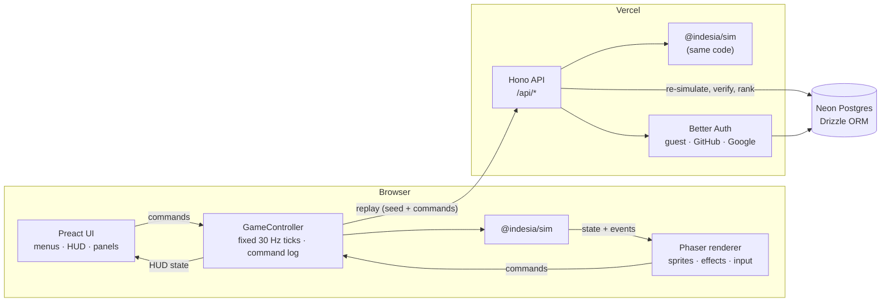

# Indesia: Tower Defense

_The last road of Indesia must hold._

Indesia is a pixel-art fantasy tower defense game you play in the browser. Build archers,
cannons, mages and frost towers along the kingdom's last road, upgrade them into
specializations, and stop armored knights, spectral wraiths and winged swarms from breaking
through.

> **Status:** v1 feature-complete, playable locally. Not yet deployed.

## The game

- **Campaign:** 3 maps (Kingsroad Meadow, Fenmarsh Crossing, Grimspire Pass) with 15–20
  waves each and 1–3 stars per map. Each map unlocks the next and ends with an Orc Warlord.
- **4 towers, 16 forms:** every tower has two levels, then specializes into one of two
  forms (e.g. Archer → Longbow Nest or Ranger Lodge).
- **7 enemies** that call for different answers: armor stops arrows and shells, magic resist
  stops spells, bats fly over cannons, shamans heal the horde.
- **Play instantly as a guest.** Optionally link GitHub or Google to keep progress on every
  device.
- **Honest leaderboards:** every submitted score is re-simulated on the server from its
  command log before it is ranked.
- Desktop first; playable on touch devices in landscape.

### Controls

| Action                      | Mouse / keyboard                                  | Touch                            |
| --------------------------- | ------------------------------------------------- | -------------------------------- |
| Pick a tower                | Build bar, or keys `1`–`4`                        | Build bar                        |
| Place it                    | Click a grass tile (Shift keeps placing)          | Tap a tile, tap again to confirm |
| Cancel                      | Right-click or `Esc`                              | Tap the tower button again       |
| Select / upgrade / sell     | Click a tower; `U` upgrades, `T` cycles targeting | Tap a tower                      |
| Start or call the next wave | Wave button or `N` (early calls pay bonus gold)   | Wave button                      |
| Game speed / pause          | `F` cycles 1×–3×, `Space` pauses                  | Top-right buttons                |

## Architecture



A pnpm monorepo in strict TypeScript:

| Path              | What it is                                                                                         |
| ----------------- | -------------------------------------------------------------------------------------------------- |
| `packages/sim`    | Deterministic, engine-free game simulation. Runs identically in the browser and on the server.     |
| `packages/shared` | Zod schemas for the API and the save format (with a merge that never loses progress).              |
| `apps/client`     | The game: Phaser renders the world, Preact renders menus and HUD, Web Audio synthesizes all sound. |
| `apps/api`        | Hono HTTP API, deployed as a single Vercel Function under `/api`.                                  |
| `tools/`          | Pixel-art generator (`pnpm art`) and the ASCII → Tiled map converter (`pnpm map`).                 |

**Why it is deterministic.** The simulation advances in fixed ticks, uses only a seeded PRNG
and integer math, and changes state only through commands; ESLint forbids `Math.random`,
trigonometry and wall-clock time inside `packages/sim`. Any game can therefore be replayed
exactly from its seed and command log. The server uses that to verify scores, golden replays
in CI catch accidental rule changes, and it leaves the door open for lockstep multiplayer.
Every change that alters outcomes bumps `SIM_VERSION`, which starts a new leaderboard season.

**Content is data.** Towers, enemies and economy live in typed, Zod-validated files; maps are
[Tiled](https://www.mapeditor.org) JSON plus a wave script. A validator checks every map
(paths, build space, boss on the final wave) and a reference bot must earn 3 stars while a
lazy bot must not, so balance regressions fail CI.

## Getting started

Requires Node.js 24+ and pnpm 12 (`npm install --global pnpm@12`).

```bash
pnpm install
pnpm dev
```

This starts the game on http://localhost:5173 and the API on http://localhost:8787/api.
The API needs no setup: without `DATABASE_URL` it runs an embedded Postgres (PGlite) stored
in `apps/api/.data`. Copy `.env.example` to `.env` to use a real database or enable
GitHub/Google sign-in.

| Script                                     | Does                                                    |
| ------------------------------------------ | ------------------------------------------------------- |
| `pnpm test`                                | Unit, integration and golden-replay tests (Vitest)      |
| `pnpm test:e2e`                            | Playwright smoke test (uses the installed Edge locally) |
| `pnpm lint` / `pnpm typecheck`             | ESLint / TypeScript across all workspaces               |
| `pnpm --filter @indesia/sim balance`       | Balance report and validation for every map             |
| `pnpm --filter @indesia/sim golden:update` | Re-record golden replays after an intended rules change |
| `pnpm art`                                 | Regenerate sprites and tiles from `tools/art`           |
| `pnpm build:vercel`                        | Build `.vercel/output` (client + API function)          |

## Deploying

1. Import the repository into Vercel (framework preset "Other"; `vercel.json` sets the
   commands).
2. Add Neon from the Vercel Marketplace; it provides `DATABASE_URL`. Migrations run during
   the build.
3. Set `BETTER_AUTH_SECRET` (and `BETTER_AUTH_URL` for a custom domain). Optionally add
   GitHub/Google OAuth credentials; see `.env.example`.

## License

Code is released under the [MIT License](LICENSE). Art and audio are original to the project;
fonts and libraries are listed in [CREDITS.md](CREDITS.md).
